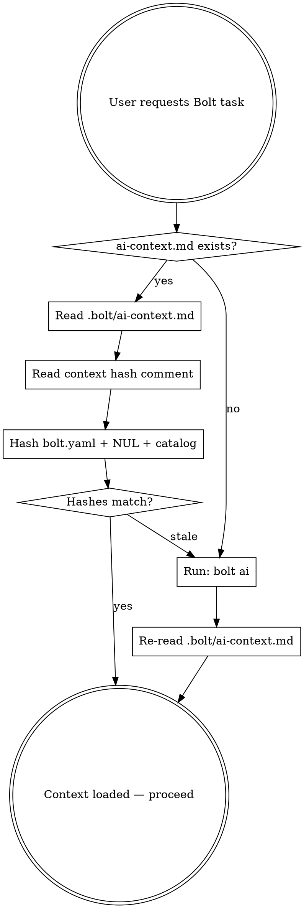

# Bolt — UE Workflow Automation

Bolt is a CLI tool for automating Unreal Engine workflows. Each project has its own `bolt.yaml` defining available commands. **You must never assume commands — always load the project-specific context first.**

## Context Loading (MANDATORY FIRST STEP)

Before executing ANY Bolt command, you must load the project's AI context. Follow this exact sequence:



### Step 1: Locate bolt.yaml

Bolt discovers `bolt.yaml` by walking up from the current working directory. If you know the project root, look there. Otherwise:

```bash
# Find bolt.yaml (Bolt searches upward from cwd automatically)
bolt check
```

If `bolt check` fails with "bolt.yaml not found", you are not in a Bolt-managed project.

### Step 2: Load or regenerate ai-context.md

Read `.bolt/ai-context.md` relative to the `bolt.yaml` location. If it does not exist, generate it:

```bash
bolt ai
```

### Step 3: Validate freshness

The header names the digest and its inputs:

```
<!-- context hash: 01139e81e95468a7 -->
<!-- inputs: bolt.yaml, plugin manifests -->
```

That digest is the first 16 hex digits of SHA-256 over the raw `bolt.yaml` bytes, one NUL (`\0`), then the catalog JSON. `sha256sum bolt.yaml` leaves out the catalog, so it will not match. `bolt.local.yaml`, source trees, and `node_modules` are not inputs. There is no freshness command.

Build the catalog JSON for the plugins `## Plugins` would list now (compact JSON, no spaces). Do not hash the markdown. Sort plugins by namespace and handlers by name. Leave out `ai: false` handlers. An empty catalog is `[]`. Always include `params` (`[]` when empty). Omit every other empty field. Key order:

- plugin: `namespace`, `description`, `handlers`
- handler: `name`, `description`, `confirm`, `params`
- param: `name`, `description`, `type`, `required`, `enum`, `default`

`confirm` is `true` only when that handler says it has side effects and the user must run `bolt run`. Do not record `ai: true`.

```text
[{"namespace":"git","handlers":[{"name":"info","description":"Show status","params":[{"name":"path","description":"Repo path"}]}]}]
```

If the file still has `<!-- bolt.yaml hash: ... -->`, or the digest differs, regenerate and re-read:

```bash
bolt ai
```

### Step 4: Use the context

The loaded `ai-context.md` contains the **complete command reference** for this project:

- All tasks (`bolt run <task>`) and their steps
- All flows (`bolt run <flow>`) and their `continue_on_fail` policy
- Loaded plugins (namespace, handlers, params)
- Defined targets
- Available flags

**Use only commands listed in the context.** Do not guess or invent commands.

## Model

- A **task** is a named list of steps (the only building block).
- A **flow** is an ordered set of tasks. Fail-fast: the first failing task aborts
  the flow, unless it is listed in `continue_on_fail`.
- One verb, `bolt run`: pass task names to run them in the order you type, or a
  single flow name to run a predefined flow. What you type is what runs — there
  is no hidden reordering.
- Step keys are strict: `uses` invokes a plugin/local action, `call` reuses a task,
  and `run` executes a shell command.
- One start notification per invocation shows top-level tasks and their recursively
  owned actions.

## Config split

- `bolt.yaml` — shared, committed contract (project identity, tasks, flows, targets). No machine paths.
- `bolt.local.yaml` — per-machine paths (engine/project/uproject), gitignored. `bolt init` scaffolds both.

## Command Syntax

### `bolt run`

```bash
bolt run update build start         # tasks: run in the typed order
bolt run daily                      # flow: run a predefined goal
bolt run build --target=client      # params (replace old variants)
bolt run build --config=debug       # build configuration param
bolt run build --config=debuggame   # aliases: dbggame, DebugGame
bolt run update build --dry-run     # preview without executing
```

### Flags

| Flag          | Effect                                                     |
| ------------- | ---------------------------------------------------------- |
| `--dry-run`   | Preview steps without executing                            |
| `--key=value` | Pass a parameter to the whole run (e.g. `--target=client`) |

### Introspection (when ai-context.md is insufficient)

```bash
bolt list                    # all tasks and flows
bolt inspect <name...>       # resolved steps for a task or flow
bolt info                    # project and VCS summary
```

## Safety Rules

1. **Always `--dry-run` first** for build, update, or any destructive operation. Show the user the plan before executing.
2. **Never run a `kill` task without confirmation** — it terminates all running UE processes.
3. **Respect fail-fast** — flows abort on the first failing task by default; do not work around an aborted flow (e.g. by re-running downstream tasks) unless the user explicitly asks.
4. **Do not modify bolt.yaml / bolt.local.yaml** unless the user explicitly asks. Configuration changes can break workflows.

## Common Patterns

**Build the editor:**
Check `ai-context.md` for the exact task name — it varies per project. Typical:

- `bolt run build` (task; may default to the editor target)
- `bolt run build --target=editor`

**Daily sync + build + launch:**

- `bolt run update build start` (tasks in typed order)
- `bolt run daily` (if a flow is defined)

**Build with a specific config or target:**

- `bolt run build --config=debug`
- `bolt run build --config=debuggame` (`dbggame` and `DebugGame` are aliases)
- `bolt run build --target=client`

## Errors

| Symptom                              | Cause                                        | Fix                                                                                   |
| ------------------------------------ | -------------------------------------------- | ------------------------------------------------------------------------------------- |
| "bolt.yaml not found"                | Not in a Bolt project directory              | `cd` to the project root                                                              |
| "bolt.local.yaml missing or invalid" | Per-machine config absent                    | Copy `bolt.local.example.yaml` → `bolt.local.yaml` (or run `bolt init`) and set paths |
| "Unknown task or flow"               | Name not defined in this project's bolt.yaml | Run `bolt list` to see available tasks/flows                                          |
| Build fails mid-flow                 | Build error in UE                            | Check the log file path printed in output                                             |
